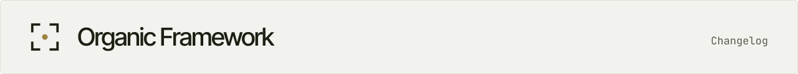

<!-- site:skip -->
<a href="README.md"><picture>
  <source media="(prefers-color-scheme: dark)" srcset=".github/readme/strip-changelog-dark.svg">
  
</picture></a>
<!-- /site:skip -->

# Changelog

Every notable change to Organic Framework, newest first. The format follows [Keep a Changelog](https://keepachangelog.com/en/1.1.0/). What each part can do today, and how far it has come, is in [`FEATURES.md`](FEATURES.md).

## [Unreleased]

## [0.2.0] - YYYY-MM-DD

OF on herdr as a plugin, one screen and one panel for the questions from all your organizations, an organization run from the conductor's chat alone, read and review work handed to Codex subagents, and agents that keep working across accounts and machines.

### Added

**On herdr**

- **OF's herdr plugin** (`herdr-plugin/`, for herdr 0.9.5). Each agent that holds a position is named by it as soon as herdr sees it and after every herdr restart, and its tab and workspace are labelled. The sidebar lists every agent, those with a question for you first; an asking agent's frame says "asks you", and its sidebar entry shows the card ID and the start of the question.
- With your yes, `of init` links the plugin, binds `prefix+a` to the questions screen when that key is free, and pins the questions panel beside your conductor unless a view already holds it. If herdr rejects the edited settings, `of init` puts the old ones back. `herdr plugin unlink organic-framework` removes the plugin.
- **The questions panel** (`of asks --panel`) stays in sight: the count in each stream, a button that opens the questions screen and, as it has room, the longest wait or the first cards of each stream. On a machine with no agent pane, such as a laptop, `of view add questions --workspace questions --tab questions --panel questions` and then `of view apply questions` open it in a tab of its own. A panel that exits restarts, and applying the view again reuses its pane.

**From the conductor's chat alone** ([`docs/remote.md`](docs/remote.md))

- `of init <org> --surface remote`, for a person who reaches OF only through the chat with their conductor (Remote Control, the desktop or the mobile app): it prints the commands that start the conductor with Remote Control on and the other agents in detached `tmux` sessions. The relay, `of who` and `of pulse` see agents in `tmux` and `screen`. The pulse types new cards, tasks and waits into the conductor's pane, and stuck requests into the person's own conductor, retrying until the pane takes them.
- Questions answered in the chat. `of asks --chat` gives the conductor the cards the person can answer there, the tasks they can do on a phone or in a browser, and a short preview of what waits for them at the machine. `of asks answer <id> --option <n> --prompt <event-id>` records an answer only from the person's own words in their conductor's session that name the card, after it opened and within 24 hours; `--text "<words>"` records a written answer quoted from those words, and `--version <n>` names the amended version they were shown.
- Provisional positions: during the onboarding, the person's yes in the conductor's chat lets the structure keeper add a project position for work nobody covers yet, and the conductor starts it. `of registry check` requires the record of that yes and flags credentials, extra tools, grants, delegated authority or unit ownership on it. Money, secrets, production and irreversible work still go to a card.

**Setting up**

- `INSTALL.md`: a guide for the coding agent that installs OF for a person, on their own machine or on a machine that stays on, reached over SSH. It gives the questions to ask, each step's command and check, and the steps only the person can take, with herdr 0.9.5 for Linux on x86_64 and aarch64 and a PyYAML install that works where `pip install --user` is refused. Python 3.11 runs OF; before 3.14, `of archive` does not run, the store keeps its data uncompressed, `of ship` sends gzip, and Codex's compressed transcripts are not read.
- `of init <org> --language <code>` sets the language agents use with you. `of owner show`, `of owner set language <code-or-name>` and `of owner set surface herdr|remote` change these settings, also before any organization exists. They are kept in `~/.config/of/owner.yaml`; English and herdr are the defaults.
- A new organization's agents start on `opus` at effort `xhigh`. `--model` and `--effort` change that on `of init` for the organization, and on `of spawn` for one start. `of resume-command` uses the organization's setting when the session's own is not known.
- `of init <org> --refresh` backs up and updates the package briefs, `AGENTS.md` and `onboarding/README.md`. It keeps local edits and places the proposed replacement beside them as `<file>.package-new`. Running setup again preserves the registered owner.
- On Linux, `of listen install` and `of relay install` start `of-listen.service` and `of-relay.service` under systemd, with a watchdog timer for the listener and logs in OF's state folder. Enable lingering with `loginctl enable-linger <user>` to keep them running after logout. `of listen uninstall` and `of relay uninstall` remove the units.

**Plugins**

- One plugin mechanism for the client and of-server ([`docs/plugins.md`](docs/plugins.md)): plugins built in, shipped with OF or installed separately. `of plugins list --org <org>` shows the implementations, where each comes from and which is chosen; `of plugins detect` suggests products for the families nobody chose yet; `of init` takes `--plugin <family>=<name>`, repeated, for the machine's choices. of-server chooses its own in `server.yaml`.
- When work first needs a secret, the conductor asks the owner to choose a store and enter the value at the machine. OF ships `1password` for service accounts, `keychain` for a solo Mac owner and `envfile` for a lab. Until a store is chosen, credentials use files. `of registry check` checks reference syntax, the selected store and, where enforced, the organization's container prefix.
- Declare MCP servers, plugins and connectors in `tools:` and assign them to units or positions. `of tools inventory`, `of tools check` and `of tools plan <position> --config-dir <dir>` inspect the setup. When spawn, move or resume builds a profile, it adds portable tools by default. `tools_mode: enforce` applies the profile's restrictions. ([`docs/tools.md`](docs/tools.md))
- A remote MCP server's sign-in can be reused across Claude accounts: `python3 bin/of_mcp_bridge.py login --url-file <file> --oauth-store <dir>`. `of tools adopt-url <server> --to <file>` copies a server's URL from Codex's settings without printing its path or query. On macOS, `of tools shared install` and `of tools shared status` run one signed-in local server for the sessions allowed to use it; a session starts its own when the shared one does not answer at launch.

**Questions and cards**

- **The questions screen** (`of asks --watch`): the queue and the open card side by side where there is room, in streams (work that is held up; money and production; for your hands; everything else). It opens on the most urgent stream that holds any. `/` searches, `g` goes to the asking agent, and a card can be snoozed, handed over or its answer undone. `of asks --watch --classic` opens the earlier layout.
- Press `r` to write below the scrollable card. `Enter` adds a line and `Ctrl+D` submits, with an extra confirmation for money or irreversible answers. `Esc` or closing the popup keeps the draft. On a machine enrolled with several organizations, cards stay distinct and answers, labels, hand-overs and snoozes go to the card's own server.
- Each filed card has a short numbered ID that chat, search and commands take, for example `of status waiting --on owner --ask <card-id>`. The prefix comes from the organization or its `card_prefix`; when two machines give out the same number, the later cards get a letter. `of asks refs` gives older open cards their IDs.
- `of ask --amend <id>`, run on the machine that filed it, corrects an open question or an unfinished task in place: its words, options, due date, blocking or steps. `--where phone|browser|machine` says where a task can be done, and `--command none` drops its command. The card keeps its ID and age, shows what changed, and refuses an answer to an older version.
- `of asks --to-me` lists the open questions routed to the calling position, oldest first. `of ask --to <position>` takes an old name or a name with the organization's prefix. A delegation's `reporting.escalate_when` may hold `ask_due < 2d`, which puts a copy in the owner's queue once the due date is less than two days away.

**Running an organization**

- `of handover propose --basis` carries a decision reference, quoted source, evidence or `inference` to the receiver. Obligation words such as `must` in the title or `--done-when` require a basis. `of model issues` flags suspected source loss in linked work. Either party can clarify an open hand-over with `of handover note <id> --note "<text>"`.
- A `move_position` diff moves a position between two units with no delegations or the same delegation parties, and updates their lists. A `rename_position` diff updates every registry reference, moves the brief and the position's own memory, and keeps the old name as an alias; `of apply` renames the live herdr agent in place. Signed grants are issued again for the new name.
- `of registry check` validates ranked goals, the conditions a team keeps, and each work's link to one of them, and warns about open work with no link. A `goal_change` diff adds, rewrites or closes them, with the owner's approval at medium tier or higher. Studio's Goals tab and `of works --goals [--json]` show each branch's doers, questions, progress, breaches, unlinked work and the month's spend at list prices.
- `of diff link <id>` prints an expiring, single-use HTTPS approval link. The page shows the proposed content and marks hidden control characters. An enrolled person can sign on a phone at any tier. `of diff apply <id>` verifies the passkey when it relies on that approval. Use a stable, phone-reachable `public_url` and protect the page and store from agent writes. ([`docs/remote.md`](docs/remote.md))
- `of org set <org> hold on` pauses pane changes by `of apply`. `of org show <org>` displays the setting and `of org set <org> hold off` releases it. Apply and pulse write `.claude/rules/of-<org>.md` for startup and compaction, with a Git exclusion at the checkout root. Nested folders inherit one copy, and shared folders receive organization-specific start context.
- A structure keeper or authorized unit owner can preview or move queued agent mail with `of inbox move <position> --to <position> --dry-run`, then omit `--dry-run` to move it. The receiving position must be active in the same organization, and the mail carries none of its former grants. `of inbox drop <position> --msg <id> --reason "<reason>"` expires one message.
- `of access map` shows credential access and local broker use where recorded. `of access request` goes to the structure keeper, who maintains lists with `of access grant` and `of access revoke`. `of access link` creates an approval link and `of access record` saves the verified approval. The Monday digest covers unused entries, expiring grants, refusals and committed additions or removals. ([`docs/access.md`](docs/access.md))

**Development loops and measures**

- A loop can name its controlled start and end events in `target.segment` and list outside factors in its `context`. The registry checks the boundaries, target and measures. Diagnosis flags matching runs, hypothesis changes or predictions, and changes of objective. Studio, `of loop show` and `of model loops --json` expose the segment, changes and predictions.
- `target.decided` cites the owner's prompt or their designated yes option on a card for that work. The keeper checks the words. Money is optional, measures can use `to_target`, and an omitted `--voi` ranks as `med`. Changing the measure requires registry approval. `of loop decision <work> reopen --hypothesis <id> --note "<reason>"` reopens a parked, kept or dropped hypothesis.
- `observed_at` says where a reading was taken. An indirect reading names its event and validity condition in `proxy_for` and counts toward acceptance only when the condition held. Studio and `of loop show` mark an unverified event as unobserved, while `chain_proxy_for` labels an indirect link to money without discarding the direct measurement.
- For a metric that is neither the target's nor a declared measure's, a hand-run `of loop run` needs `--observed-at` with `--direct`, or with `--proxy-for` and `--valid-when`. A runner may record such a run unlocated, and `of loop locate <work> --run <id>` adds its reading point later, with the same flags.
- `of loop wait <work> --on <kind> --ref <what> --until <time>` records a dependency and its expected end. Studio, `of loop show` and start context share the work's clock. With a hypothesis in testing and no loop progress or qualifying wait, the pulse nudges available owner and doer positions after 4 hours by default, and the conductor after 8, once per recipient per episode.
- `of tempo judge` looks for a basis for deferring scheduled tasks, clock waits and plans passed up the organization. `of tempo list` shows findings, `of tempo replay --since <time> --until <time>` rechecks bookings, and `of tempo outcomes` reports signs of a response. `of tempo sample` creates a blind sample and `of tempo score --out <labelled-file>` checks precision and recall. The corrections digest counts tempo corrections.
- `of model coupling --org <org>` shows dependencies across positions and units from messages, hand-overs, owner questions and shared work. `of model usage` shows a delegated unit's monthly budget, fresh tokens and list cost by position and day, and token shares by model. `of issues label --file <file>` labels a batch and names the issue IDs it cannot match.

**Subagents on other harnesses**

- An owner can give standing permission for parallel subagents through `subagents` in the registry, backed by their recorded words. `of spawn` and session start context carry that permission. Agents changing files use separate worktrees, and the calling position owns the decisions, checks and communication.
- An organization opts into outside runs with `subagent_harnesses` on its committed default branch, choosing repositories, kinds of work, excluded paths, snapshot size and checks on outgoing material. After `of subagent selftest --harness codex` passes, `of subagent run` can read or review a tracked revision with web access disabled, or research the web in an empty workspace. Codex runs on macOS and on Linux with `bwrap`.
- After the Codex selftest passes its patch checks, `of subagent run --harness codex --kind patch --workspace <checkout> --at <commit> --prompt-file <file>` saves a diff for the caller to inspect, apply and test in its own worktree. OF rejects changes to protected instruction, settings, Git and CI paths, new symlinks and newly executable files. `of subagent muse-login` prepares a separate sign-in. Muse runs stay blocked while its file tools can read it.

**Capacity and accounts**

- `of account list` shows Claude accounts, 5-hour and weekly usage, and live session counts. `of account adopt`, `of account add <name>` and `of account remove <name>` maintain `~/.config/of/accounts.yaml` and keep removed accounts' folders. `of claude --account <name>` launches directly on a named account. A fresh launch honors `CLAUDE_CONFIG_DIR` or chooses by folder trust and capacity. `--resume <id>` looks up the session's account.
- On a machine with several Claude accounts, `of init <org> --capacity yes|no` chooses whether to enable rescue and add `<prefix>_capacity` from `bench/capacity`. First unattended setup files a card if the choice is open. `of capacity move <position> --restart` reloads the session's tools, deny rules and memory settings on its own account and model. `--reason` goes in its hand-over note.
- In `capacity.yaml`, `stay` limits automatic moves to rescue. `start_in` returns listed sessions to their registry launch folder on a move or restart when the folder exists and is trusted. `restore_moves` defaults to two per pass and limits moves of idle sessions to accounts that can restore a missing plugin or account-bound tool.
- `of capacity spend --month <YYYY-MM> --org <org>` shows fresh tokens and list cost by work, goal branch and condition for the current or previous month. `of status working --work <id>` declares the work explicitly. The report lists unattributed use by position. Omit `--org` to see unheld sessions and completed outside runs by harness and model.
- `of capacity status` also shows Codex's plan and limit windows and Muse's model and contributor mode. `of capacity training` shows the training settings, and `of capacity training codex --set off --source <card>` records the owner's completed confirmation for private runs. Organizations sharing the account can reference the same verified decision through `training_cards`.
- `of capacity carry prepare --only <org>` prepares the sessions. `of capacity carry copy --bundle <dir> --to user@host:<dir> --key <file>` copies them over SSH, and `of capacity carry restore --bundle <dir> --org <org>` restores them across macOS and Linux. Restore translates home and scratch paths and preserves conversation history, rewind data and position memory. `--consents <card>` carries eligible trust and Bypass Permissions acceptance on the owner's unamended approval naming the destination.

**The server and several machines**

- `of init <org> --server-port <port>` gives a second organization user on the same machine its own loopback server address and keeps the shared shipping default. For unattended enrollment, `--yes` consents to typed records. `--raw <org> --yes` also consents to raw records when the invitation offers them for that organization. ([`docs/server-several-machines.md`](docs/server-several-machines.md))
- `of server tls-init` prepares a TLS listener for the server's next start. On a Mac, `python3 deploy/host/forward.py install --to <user>@<host>` maintains a reverse forward to the restricted Unix socket using the dedicated key and pinned host key. `of enroll <https-server> --org <org> --pin <certificate> --socket <absolute-path> --code -` pins the certificate and prompts for the invitation code without echo.
- On macOS, `deploy/host/setup.py` makes existing organization homes private, creates a server account, configures loopback services and pins the key supplied with `--grant-pub`. `deploy/host/plane.py` checks a pinned revision as an organization user and keeps the previous release if the check fails. On Linux, `python3 -I deploy/host/contours.py plan` previews the accounts and mailboxes named with `--org-user`, `--keeper` and `--channel`. `apply` verifies the named admin's access before removing organization users from `wheel`.
- `of health` and the owner's Health tab show failed checks first, with readings, limits and responsible positions. `GET /v1/health/checks` reports the longest recent `/v1/health` response time and how long the oldest eligible message has been observed waiting for a live, idle agent. On macOS, `of health install` schedules local checks. `of studio --file <path> --view health` exports the page.
- Only lasting `server.health` and `relay.oldest` failures open a card for the person, since the other alerts travel through the relay. `of smoke --index` checks the staged changes and `of smoke --ref <ref>` a revision. `of rollback <commit>` reverts one commit whose paths have no uncommitted edits, and keeps every other edit.

**Recording and the store**

- `of prompts --mine` lists the prompts a person typed into the calling session, newest first, with each one's event ID, time and first line. `--last <n>` sets how many, and `--all` adds relayed, scheduled and injected prompts.
- The listener starts `of archive` hourly, and the session-end hook requests a copy of the ending transcript. With Python 3.14+ zstd support, the archiver copies new files first, appends detected growth and keeps the previous copy when it detects a rewrite. Manual runs accept `--path`, `--budget` and `--quiet`. `of db stats` shows the archived file count, compressed size and newest copy time.
- `python3 bin/of_merge_delta.py --source <copy> --target <store> --org <org> --since <cutover>` merges one organization's history after a machine move and can safely resume an interrupted merge. `--dry-run` previews it. `--person-acts <event-ids>` selects the human actions the operator has verified.

### Changed

- The README puts installation with an agent first and shows light or dark header artwork. The installing agent, conductor and onboarding lead run commands themselves, explain each step in plain words and tell the person where to act for a login, folder trust or approval. Without herdr, detached onboarding agents use `tmux` when available and otherwise `screen -U`.
- Onboarding offers hands-off work, approval before each new source and step, or the owner's own format. The lead records the choice and authorized sources in `onboarding/charter.md`, reads material the person supplies and offers an export, link or connector if it cannot open a source. The head reviews the charter and draft people map together and confirms the map before a diff assigns anyone a position.
- `of registry check` warns about missing `evidence` on human holders, their owned decisions, human-held system keepers, external governors and external work doers. A disputed registry fact goes to the structure keeper by hand-over. The keeper continues as the organization's architect after onboarding, watches its OF health and routes framework problems through the support guide. ([`docs/getting-help.md`](docs/getting-help.md))
- OF uses the owner's language for catalogued text in questions, tasks, notifications, pane messages and `of conductor panel`. Some notices and nudges still use English. Russian is the first catalogue in `bin/locale/`, with English as the fallback. The conductor panel reads `title` from its local request ledger and falls back to the older `title_ru`.
- The relay joins each agent's messages from a poll into one prompt. It normally delivers when the agent is idle or done. A batch waiting five minutes can reach a working pane. `of send --fyi` leaves mail in the inbox and can tell the sender that an idle recipient will read it next turn. New organization instructions explain `of inbox --mine` and `of inbox --mine --take all`.
- `of send` resolves former names to current holders and directs senders away from finished or unheld parked positions. For a held parked position with an active successor, it names the successor and requires `--to-parked` unless the sender is the successor, unit owner or structure keeper. Across organizations, `--reply-to` can reply to the original sender while their message is queued, leased or delivered, within the reply window and without conveying authority.
- Account selection favors accounts accepting work, then those below their thresholds, then remaining capacity weighted by plan value. The balancer accounts for resets and recent arrivals from other machines, deduplicates threshold cards and can wake a stopped session after its account reopens. In that user's `capacity.yaml`, `account_cards: false` suppresses threshold and pool questions while keeping session-specific alerts.
- A manual account move stops for a missing required sign-in and files a task when signing in would fix it. Other plugins and connectors the session used are checked and can produce a warning. Rescue can proceed and tells the holder where to report missing tools. The balancer reconciles sign-in tasks, skips parked and finished positions, and can rescue a session still stopped after a wake.
- `of who` timestamps the pulse's saved attention list. Studio refreshes cached pages in the background and uses local listener views for questions, pull requests, applied diffs and loop history, including relevant earlier events. Its footer shows when the questions view is late. `of listen status` compares fold views with their own lag limits. `of model escalations --fresh` computes the current result from the log.
- Diagnosis flags repeated owner corrections after frequent compaction or on work lacking recorded verification. It combines backlog aliases and accounts for routine coordination when identifying chatty pairs. Eligible noncritical findings confined to a delegated unit go to its owner. `of issues --json` includes labels on open findings. The structure keeper's digest separates findings already labelled from those needing a decision.
- `of import github --org <org>` records masked PR descriptions, review counts and verdicts from the latest 100 comments. It skips unchanged work records and reports the count when positive. A verdict naming the work's own position does not count as independent review. `of import git --org <org>` records the masked message below the subject. Both body fields are capped at 2,000 bytes.
- The low-disk card names measured swap, event-store, project scratch and checkout worktree usage. The pulse tells an idle structure keeper once per episode when its organization's live scratch in one project, or its measured checkout worktrees together, reaches 12 GiB. A watch that references a session scratch path gets a reminder to keep its script in persistent storage.

### Removed

- The question counts that earlier builds put on workspace and tab labels: the herdr plugin clears them, and an open question to you is marked on the agent that asks it instead.
- `of asks send-outbox` is gone. The questions screens record pending answers and marks once as they close, and `of asks deliver --now <event-ids>` delivers the recorded answers. Recoverable answers from the old outbox appear as failed drafts for you to send with `D`, and old closure or withdrawal requests leave the cards open.

### Deprecated

- `of send --urgent` is accepted for older scripts. Ordinary sends now have the same delivery timing.

### Fixed

- `of init <org>` installs and checks the relay and listener before agent startup. If either fails its running check, it prints recovery instructions and exits 2. `of status <state>` warns about a missing local relay. `of send` warns when queued mail has no reported holder or its local holder lacks a relay. On macOS, `of relay on` can install the service. `--no-service` prints `of relay run` and `of listen run`.
- herdr's hooks, panels, starts and resumes find a Python with OF's PyYAML, a virtual environment included. After a herdr restart, `of claude --resume <id>` needs no shell function: it finds the account that holds the session, gives its model and effort when known, and restores bypass mode when the session ran in it. `of spawn` retries the brief while herdr is still detecting the agent, presses Enter once on a brief left in the input box, and names the pane when delivery fails.
- The relay reads input in narrow panes, beside a diff and with a partly hidden border. It waits when it detects a person's draft, including multiline input. A recent hook record can confirm delivery while still queued, and the relay can submit its own stranded paste once. `screen` clears its paste buffer first so a failed buffer read cannot resend the preceding message.
- After a server move, `of inbox --mine` can list and take mail, including FYIs, from the current server and those in `drain_from`. It reports an unavailable old server separately. When the receiving server supports presence merges, a job or cross-server send preserves the machine's other registered holders and their inbox access.
- The listener folds openings, answers, amendments and late events in time order. Questions and the panel combine its view with recent changes during lag or restart. A failed queued send brings back the card and draft for retry with `D`. Turn-end hooks can deliver pending answers while the listener is down. Hand-over and withdrawal commands retry a missing target after draining queued records.
- A missing or finished registry addressee triggers one notice to the asker, naming a known successor. Escalation uses one ID across machines, and answering its copy settles the original. The judge recognizes filed cards, proposed diffs and waits on the recipient. A failed API connection defers pulse retries and leaves the last desk case in place. Candidate and case age limits still apply.
- Reproposing identical pending or approved diff content retains the answer on its newest answered popup card. Setting a position's list replaces it. Unchanged items in readable block lists keep their original lines and comments. Inline lists keep their form and trailing comment. Invalid registry YAML can fall back to HEAD, and an otherwise valid grant past its own expiry raises a warning.
- The checker, model and mandate router agree on ranges and negated classes for concrete paths. Without a checkout, the checker estimates overlap conservatively. The router recognizes linked worktrees and repository-name prefixes. Off-map findings show edit date ranges and current keepers, and subsystems inherit their unit. A brief edit alone does not trigger an unclear-mandate finding.
- OF fits enrolled sessions' start context to a 9,500-character target and keeps identity and mandate whole. When it cuts sections, the first line names them and points to the full context or source files. The keeper's digest names affected positions. `of registry check` warns about active positions with a brief and no `enrolled: true`, except those held by a person.
- An inconclusive probe alone leaves healthy sessions in place. A failed API connection check defers moves, while an observed stop can qualify a session for rescue. Rescue prefers destinations with room and excludes known model mismatches, including Pro for Fable. If the capacity keeper is itself stopped, its alert goes to an available conductor or the owner.
- Moves keep worktrees and read-only history, set feedback drafts aside, clear recalled shell input and wait for the mode footer before changing it. OF rechecks the limit dialog and dismisses its own late exit dialog only without a later recorded human prompt. Move and reboot notes identify the account and explain which schedules to check. Cross-machine restores ask sessions to recreate schedules they still need.
- Account checks reread plugin state after installation or settings changes and match the full plugin ID for catalogue entries that specify it. Due probes run in parallel, and the pulse reuses recent balancer readings. An unknown reading keeps a still-needed sign-in task open. The blocked-session detector ignores quoted login instructions and old limit messages followed by a completed turn.
- `of import git` resolves each main checkout's default branch, honors `branches` in `orgs.yaml` and reports ambiguous or missing defaults. Flow counts the imported commits. Transcript imports, spend updates and store merges release the write lock between batches. Hooks drain during listener startup and between transcript imports. After initial catch-up, background jobs and budgeted view updates leave time for the pulse and booking reminders.
- Loop waits use the earliest current dependency. Repeating a wait can shorten it, an answered or withdrawn card ends its wait, and a reply silences nudges for a declared peer wait. Calendar and holdout waits leave the stall clock running, and a long-wait notice names only the wait that governs it.
- Tempo interprets session schedules in local time and asks its judge to respect a dependency's stated date or hour and distinguish past reports from future bookings. An idle agent can receive one reminder per fresh judgment to start work booked without a basis or name its dependency. Expired bookings drop out. Studio resolves owner-chosen measures in the work's organization and compares fractional shares with percentage thresholds.
- On macOS, watchdogs request thread stacks before restarting a stuck server, listener or relay. A listener making progress during catch-up keeps its watchdog informed. `SIGUSR1` can log stacks safely as a thread exits. Studio records background refresh timings and failures in `.refresh.log` and continues to other organizations when one organization's data preparation fails.
- The server applies `request_timeout` to idle connections, keeps batches queued while storage is unreachable and records one owner alert after 30 minutes. Its image includes the health, secrets broker, grant-limit and question-option modules. Concurrent relay and listener starts share one machine key pair. `of server enroll-machine` keeps an active tenant by default, with `--no-tenant` to demote it and `--tenant` to promote a machine.

### Security

- Chat answers require a recorded human prompt attributed to the person's conductor. Free text must come from that prompt. The answer check holds recognized money, production, security-incident and irreversible risks found in any merged member's tags, wording or steps, or in the first member's options. `of diff approve <id> --prompt <event-id>` refuses every tier.
- Terminal, popup and passkey approvals bind the full SHA-256 digest. A popup approval must start with a whole approval word. Repropose a diff with an old shortened digest before approval. `of passkey enroll <person> --org <org>` signs after the owner confirms the phone and terminal codes match. `of passkey revoke <person> <credential> --org <org>` saves the signed revocation, attempts server notification and lets verifiers remember it.
- OF attributes `of asks answered` and `of asks withdraw` to the owner when stdin is a terminal and no known agent marker is present. The guard checks caller markers across option orderings and shell substitutions, warns about manufactured decisions and marks identifiable pane injections. It blocks recognized writes to `asks-outbox`, `asks-drafts` and `asks-reply-drafts` under the default state root and the hook's `OF_STATE`.
- `of grant rekey` re-signs grants through the owner's 1Password SSH agent, verifies the signatures and attempts to remove the old private key file. OF rejects signing from recognized agent sessions and automation. Legacy HMAC signatures are untrusted by default. A message claiming grant authority needs explicit `to_org` scope across organizations or `to_positions` within one.
- Secret-tier and higher keeper access requires the owner's passkey approval of the canonical access entry. Money and production access also require a current signed grant covering the position, keeper access and limits. Mark signing and money-moving credentials `custody: true` to exclude their files and matching copies from transfers. OF reports retained transcripts containing a recognized private-key header.
- `tools_excluded` can disable plugins, MCP URLs and connectors across an organization at launch. The live guard checks recognized plugin and claude.ai connector calls. Account sign-ins labelled in `capacity.yaml` require a matching profile `signin`. Shared-server authentication checks the launched or resumed session and its tool configuration, and the guard blocks direct shell calls that would print the token.
- Signed deny rules can restrict Kubernetes kinds and namespaces, SSH destinations, jumps and forwards, and selected CLI commands, options, environment settings and imports. `scope.kubectl.allow_exec` can allow exact arguments for pod patterns. `scope.ssh.allow_jump` can allow a named position a gateway route. Replay reports validation errors separately for selected Kubernetes and SSH grants and can break down SSH matches by destination.
- The guard covers configured Keychain services, listed cloud caches, Codex and Muse sign-ins, recognized private-key files, `executors*.txt` and names containing `secrtets`. It blocks recognized secret-bearing Kubernetes output, shared-store value commands and unsupported escapes in local `sed` or `awk` patterns. Supported searches of small names-only inventories remain available. Recorded denial reasons pass through OF's masker.
- Secret and protected-path checks cover quoted or escaped paths, home-relative paths, wrapped and versioned interpreters, nested shell commands and programs configured through Git. Commands beyond the guard's nesting limits are refused. Remote script checks verify the committed bytes locally, and the guard guidance calls for secret comparisons and rotations to run where the values live.
- The guard protects installed OF and herdr plugins, protected scripts and job definitions, the configured Claude executable, `~/.config/of/orgs.yaml` and `~/.config/of/views.yaml`. Use `of org set` or the `of view` commands for supported changes. With all machines upgraded and `ff` configured under `protected_code`, `of protected ff <path> --to <commit>` can advance a clean worktree to a verified merge that passes the required checks and preserves owner-controlled paths.
- OF-launched agent sessions stop Git's upward repository search at home. The guard blocks making home a repository and recursive deletions that can resolve to home, root or the whole working directory. `of hooks install --guard` upgrades the guard-hook timeouts. Automatic handling of a bypass-mode Bash permission dialog rechecks the command and leaves designated sensitive decisions to the person.
- `of redact` overwrites bytes freed by the redaction, replaces searchable event text with its masked form and retries truncating a write-ahead log held open by a reader. Secure removal of old search terms requires SQLite 3.42 or later. Use `of listen rebuild` for cached views and `VACUUM` for fragments left by earlier database writes.
- `server_access` reads the machine's token from a current-user-owned file with no group or other permissions. It sends the token only to configured HTTPS server addresses and refuses redirects. The image build applies Debian updates, omits `pip` and inventories `ssh-keygen` and its copied libraries in CycloneDX. Copy by digest or build a pinned revision. CI adds source and revision labels and reports high and critical scan results beside the pushed digest.
- The reference policies admit selected ingress or connector pods to OF and server pods to ClickHouse. On upgrade, put the connector's namespace and pod selectors together in one `networkPolicy.ingressFrom` entry. Check `networkPolicy.dnsTo` and `networkPolicy.gitSyncTo`, and verify enforcement with `deploy/netcheck.py`. ([`deploy/RUNBOOK.md`](deploy/RUNBOOK.md))
- The reference ClickHouse image moves to `clickhouse/clickhouse-server:26.8` for the LTS fix for CVE-2026-116366. Back up the vault volume and review incompatible changes before upgrading. Kubernetes checks for a new patch at each container start and Compose at `docker compose up`, with cached-image settings and required password files in the runbook. ([`deploy/RUNBOOK.md`](deploy/RUNBOOK.md))

## 0.1.0 - 2026-11-11

The first public release.

### Added

- **The organization model.** A registry of positions in each organization's own repository (`registry/positions.yaml`), held by people and by agent sessions alike: canonical names `<system>_<role>`, systems with keepers, units, delegations, works and goals, a credentials catalogue. `of registry check` validates it. Signed grants (`of grant`) say what a position may do beyond its organization or the guard.
- **Starting an organization.** `of init` creates the organization's repository with the owner's conductor as its first position and the onboarding unit from the onboarding package (`bench/onboarding/`), installs the recorder hooks after asking, and starts a local of-server. `of spawn` starts a position's agent in its place, on the Claude account with the most headroom, with its brief.
- **Seeing and steering agents on herdr.** `of who`, `of apply`, `of go`, `of view` and the desk (`of desk`), which keeps the agents of the owner's current case in view. The pulse (`of pulse`, inside the listener `of listen`) finds who waits on whom and nudges idle peers.
- **Questions, messages and hand-overs.** Questions to a person as cards with options and a recommendation (`of ask`, `of asks`, the popup); declared state at the end of each turn (`of status`); messages between positions, typed in when the receiver is idle (`of send`, `of inbox`, the relay); hand-overs with a checkable end (`of handover`); structure changes applied only after the owner approves their exact text (`of diff`); `of delegate`, which names the position whose mandate covers a task.
- **Recording.** Every Claude Code session recorded by hooks (`of hooks install`); history brought in by `of import`; typed events derived from it (`of derive`); merged pull requests and commits as work records (`of import github`, `of import git`); shipping to the organization's server with consent per organization (`of ship`, `of consent`, `of shipped`).
- **The server.** of-server with SQLite on one machine (profile 1); enrolling machines and people (`of invite`, `of enroll`); positions held on several machines, tested in the lab; a self-hosted server on a VM (profile 2, `deploy/`), tested in the lab.
- **Guard and secrets.** The guard denies critical actions before a tool runs (secret files, printing secrets, memory reads, file mentions); an organization's own signed deny rules; secrets masked in traces and removable from every stored copy (`of redact`); a broker that serves a credential to the position's holder at the moment of use (`of secret run`).
- **Capacity.** Limits per Claude account (`of capacity status`); moving a session to another account between turns (`of capacity move`, `of capacity balance`); every session back on its account after a restart (`of capacity reboot`); resuming a session on its own account and mode (`of resume-command`).
- **Model, measures and diagnosis.** The organization model and its measures (`of model`, `of studio`, `of works`); anti-patterns found and labelled by the owner (`of issues`, the catalogue in `docs/diagnose.md`); development loops (`of loop`); the owner's corrections as records (`of corrections`); the before-and-after measure of adopting OF (`docs/measure.md`).
- **The lab.** Isolated environments and scenarios that test OF itself (`lab/`).
- **The framework's documents** in `docs/`: mission, ontology, method, systems, the registry and event schemas, the RFCs.
- **License:** Apache License 2.0.

[Unreleased]: https://github.com/organic-framework/organic-framework/compare/v0.2.0...HEAD
[0.2.0]: https://github.com/organic-framework/organic-framework/releases/tag/v0.2.0
