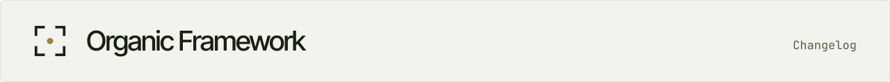

<!-- site:skip -->
<a href="README.md"><picture>
  <source media="(prefers-color-scheme: dark)" srcset=".github/readme/strip-changelog-dark.svg">
  
</picture></a>
<!-- /site:skip -->

# Changelog

Every notable change to Organic Framework, newest first. The format follows [Keep a Changelog](https://keepachangelog.com/en/1.1.0/). What each part can do today, and how far it has come, is in [`FEATURES.md`](FEATURES.md).

## Unreleased

### Added

- Disk: the pulse tells an organization's structure keeper once when its own live sessions in one project folder pass 12 GiB together, listing only those sessions, and the low-disk card names what takes the space: swap, OF's event store, and the live sessions' temporary folders by project. `of.disk_usage` carries the swap, the store and the projects.
- Development loops: **where a reading is taken**. The target and each measure name the point where their reading is taken (`observed_at`). A measure that reports an event happening somewhere else is a proxy (`proxy_for`, with the condition under which it stands for that event). A run on a proxy records whether the condition held; until it held, the run records no accept, `of loop` refuses a keep or a drop that rests only on such runs, and the loop shows "not observed" where the event happens. AGENTS.md gains the rule for every conclusion and relay: a conclusion about an event rests on readings taken where it happens (docs/registry.md, Works; RFC 0005 §4.3).
- Development loops: **the owner's measure**. A loop target may carry `decided`, the person's yes on that measure, read from the registry only and resolved in the event log. Then the target needs no `money`, which becomes a reading beside it; each measure chains to the target by `to_target` or to money; `of loop hypothesis` takes no `--voi`, and an absent one ranks as `med`; the check proves who said it and shows the words, and only the structure keeper cites the yes, so `of loop decision change_objective` is refused on such a loop. No position asks the owner to prove that measure in money. The plateau question and every gate on an act stay.
- `INSTALL.md`: a guide for the coding agent that installs OF for a person. It gives the questions to ask, each step's command and check, the steps only the person can take, and a recommended setup on a machine that stays on, reached over Tailscale.
- `of init --language`: the language agents use with the organization's head, one explicit setting kept in `~/.config/of/owner.yaml`.
- `of init --surface remote`, for a head who reaches OF only through the chat with their conductor (Remote Control, the desktop or the mobile app): the conductor starts with Remote Control on, and every agent starts in tmux. Kept in `~/.config/of/owner.yaml`; the design is `docs/remote.md`.
- `of init --refresh` brings a new organization's package briefs, `AGENTS.md` and `onboarding/README.md` up to date after an update. A file the organization edited is kept, with the new version beside it as `<file>.package-new`. A re-run of `of init` keeps the organization's owner.
- `of init --capacity yes|no`: on a machine with two or more Claude accounts (`of account list`), the head decides once whether agents on a spent account move to one with room, with their capacity keeper `<org>_capacity` keeping watch. Without the flag, `of init` asks in a terminal, or files one card.
- `of init` lists the plugins the machine has for OF (`docs/plugins.md`), and `--plugin family=name` writes the machine's choice to `~/.config/of/plugins.yaml`. Where the organization keeps its secrets stays its own choice, made when the first secret is needed.
- One locale layer: every string OF shows a person is English in the code and comes in their language (`language` in `~/.config/of/owner.yaml`) from a catalogue, `bin/locale/<lang>.json`; a missing entry shows the English. Russian is the first catalogue.
- A default model and effort per organization: `of init` writes `agents: {model: opus, effort: xhigh}` on the organization's entry in `orgs.yaml` (`--model` and `--effort` change it). `of spawn` starts with it unless `--model` or the new `--effort` says otherwise; `of resume-command` falls back to it when a session names neither.
- Hand-overs carry a basis: `of handover propose --basis` takes an ask id, a quoted source, evidence or `inference`, and a title or done-when that states an obligation is refused without one. `of handover note` adds a note to an open hand-over without changing its state.
- `of diff` move_position: a position moves between two units delegated alike, and each delegation's list follows it.
- `of model usage`: a delegated unit's month per position, day and model.
- `of grant rekey`: the grant-signing key moves into the owner's 1Password SSH agent, and grants are signed through it from then on.
- The diagnosis rule `unsourced-requirement`: a claim that drives work lost its basis on the way.

### Changed

- of-server's chart and ClickHouse manifest isolate both inside the cluster (`deploy/RUNBOOK.md` §4.1). On upgrade: `networkPolicy.ingressFrom` must name the connector's pods by labels (the default `app: cloudflared` may not match a running connector, and an entry with a namespace alone, an empty selector or an empty namespace selector fails the render); DNS egress goes only to `networkPolicy.dnsTo`, the `kube-dns` pods by default, so a cluster with a node-local cache adds its address; git-sync reaches only `networkPolicy.gitSyncTo`; `deploy/clickhouse/clickhouse.yaml` adds a default-deny to the ClickHouse namespace and admits only of-server's pods, from the namespace `of-server`. `deploy/netcheck.py` proves the result in a cluster.

- Grants signed with the old HMAC signature are no longer trusted.
- The guard takes `executors*.txt` and file names with the misspelling `secrtets` for secret files.
- The conductor's and the onboarding lead's briefs: do everything they can themselves, and say at each step in plain words what they do and why.
- The README follows the OF design: the photograph and the type of the design, light and dark; "install it with your agent" comes first.
- No agent asks the organization's head to run a command. The head may talk to agents through Remote Control, the desktop or the mobile app, where a command typed into the chat does not run. The conductor asks in words and starts the onboarding lead itself; what only the head can do (a login, trusting the folder) is a step in words with its place. Without herdr, every agent but the conductor starts in a detached `screen` session. `INSTALL.md` tells the installing agent the same.

### Fixed

- The quickstart's PyYAML step: Homebrew's Python and recent Linux Pythons refuse a plain `pip install --user`.
- On a new machine the relay never started, so agents' messages did not arrive. `of init` now installs the relay and the listener as user services and checks that each runs; it exits with code 2 when one does not. `of status` and `of send` warn when no relay runs on the machine, and `of relay on` installs the service when it is missing.
- Capacity: a probe that got no reading (the network down) no longer moves sessions ahead of a stop, and `of capacity balance` makes no move while the API does not answer.

## 0.1.0 - 2026-11-11

The first public release.

### Added

- **The organization model.** A registry of positions in each organization's own repository (`registry/positions.yaml`), held by people and by agent sessions alike: canonical names `<system>_<role>`, systems with keepers, units, delegations, works and goals, a credentials catalogue. `of registry check` validates it. Signed grants (`of grant`) say what a position may do beyond its organization or the guard.
- **Starting an organization.** `of init` creates the organization's repository with the owner's conductor as its first position and the onboarding unit from the onboarding package (`bench/onboarding/`), installs the recorder hooks after asking, and starts a local of-server. `of spawn` starts a position's agent in its place, on the Claude account with the most headroom, with its brief.
- **Seeing and steering agents on herdr.** `of who`, `of apply`, `of go`, `of view` and the desk (`of desk`), which keeps the agents of the owner's current case in view. The pulse (`of pulse`, inside the listener `of listen`) finds who waits on whom and nudges idle peers.
- **Questions, messages and hand-overs.** Questions to a person as cards with options and a recommendation (`of ask`, `of asks`, the popup); declared state at the end of each turn (`of status`); messages between positions, typed in when the receiver is idle (`of send`, `of inbox`, the relay); hand-overs with a checkable end (`of handover`); structure changes applied only after the owner approves their exact text (`of diff`); `of delegate`, which names the position whose mandate covers a task.
- **Recording.** Every Claude Code session recorded by hooks (`of hooks install`); history brought in by `of import`; typed events derived from it (`of derive`); merged pull requests and commits as work records (`of import github`, `of import git`); shipping to the organization's server with consent per organization (`of ship`, `of consent`, `of shipped`).
- **The server.** of-server with SQLite on one machine (profile 1); enrolling machines and people (`of invite`, `of enroll`); positions held on several machines, tested in the lab; a self-hosted server on a VM (profile 2, `deploy/`), tested in the lab.
- **Guard and secrets.** The guard denies critical actions before a tool runs (secret files, printing secrets, memory reads, file mentions); an organization's own signed deny rules; secrets masked in traces and removable from every stored copy (`of redact`); a broker that serves a credential to the position's holder at the moment of use (`of secret run`).
- **Capacity.** Limits per Claude account (`of capacity status`); moving a session to another account between turns (`of capacity move`, `of capacity balance`); every session back on its account after a restart (`of capacity reboot`); resuming a session on its own account and mode (`of resume-command`).
- **Model, measures and diagnosis.** The organization model and its measures (`of model`, `of studio`, `of works`); anti-patterns found and labelled by the owner (`of issues`, the catalogue in `docs/diagnose.md`); development loops (`of loop`); the owner's corrections as records (`of corrections`); the before-and-after measure of adopting OF (`docs/measure.md`).
- **The lab.** Isolated environments and scenarios that test OF itself (`lab/`).
- **The framework's documents** in `docs/`: mission, ontology, method, systems, the registry and event schemas, the RFCs.
- **License:** Apache License 2.0.
