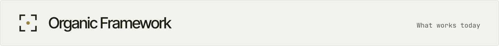

<!-- site:skip -->
<a href="README.md"><picture>
  <source media="(prefers-color-scheme: dark)" srcset=".github/readme/strip-features-dark.svg">
  
</picture></a>
<!-- /site:skip -->

# Features

What Organic Framework does today, by area, and how far each part has come. Checked against the code, the tests and the event log on 2026-11-11 by `of_docs`, and the rows new in 0.2.0 on 2026-11-12; how is at the end.

**States**
- **Works**: tested in `tests/`, and in regular use in the week before the check by the organizations that run OF today: the team that builds OF and one user organization. The evidence says where a feature is used by only one of them.
- **Early**: built and tested, but used rarely, by one organization or one person, or only in the lab (`lab/scenarios/`). Expect rough edges.
- **Designed**: written down in `docs/`, not built, or built only in part. Not something to rely on yet.

Use is counted from the event log for the seven days 2026-11-05 to 2026-11-11, both organizations together; "every day" means all seven.

## The organization model

| Feature | How | State | Evidence |
|---|---|---|---|
| Positions with canonical names, systems, roles, mandates and holders | `registry/positions.yaml`; [`docs/registry.md`](docs/registry.md) | Works | `test_of`; 386 holder changes and 103 bindings, both organizations, every day |
| The registry check: names, duplicates, YAML slips, units, works | `of registry check` | Works | `test_of` |
| Systems map with keepers, paths and dependencies | `systems:`; [`docs/systems.md`](docs/systems.md) | Works | `test_of`, `test_cells` |
| Units, delegation to a unit owner with an envelope | `units:`, `delegations:`; [`docs/handover.md`](docs/handover.md) | Works | `test_diff`; in one organization's registry |
| Works and goals, their state derived from events | `works:`, `goals:`, `of works`; [`docs/works.md`](docs/works.md) | Works | `test_studio`; in both registries |
| People as holders of positions, beside agents: the same naming, mandates and envelopes; messages to a person's position wait in `of inbox`; an agent working for a person asks that person | `people:`, `holder: {runtime: human}`; [`docs/registry.md`](docs/registry.md), People | Early | `test_of` |
| Signed grants: what a position may do in another organization or beyond the guard | `of grant issue/revoke`; `registry/grants.yaml` | Works | `test_grants`, `test_guard_grants`; 21 grants issued, both organizations |
| Credentials catalogue: which position may read which credential, denied by default; `of spawn` and resumes write the same denies into the session's own settings | `credentials:`; [`docs/registry.md`](docs/registry.md), Credentials | Early | `test_credentials`, `test_spawn`, `test_resume` |

## Starting an organization

| Feature | How | State | Evidence |
|---|---|---|---|
| A new organization's repository, structure first, no agent started | `of init <org> --owner "<name>"`; [`docs/onboarding.md`](docs/onboarding.md) | Early | `test_of` (InitStructureTest), `lab-onboarding-v0`, and the README quickstart on a clean lab VM |
| The onboarding package: eight roles and eight steps, each with its source; charter templates | [`bench/onboarding/`](bench/onboarding/) | Early | `lab-onboarding-v0` |
| Starting a position's agent in its place, on the account with the most headroom, with its brief | `of spawn <position>` | Works | `test_spawn`; 31 agents started on 5 days |
| Bringing in past sessions | `of import` | Works | `test_derive`, `test_github` |
| Installing through the person's own coding agent: the questions to ask, each step's check, the person's steps said in words | [`INSTALL.md`](INSTALL.md) | Early | the README quickstart, the same install by hand, passes on a clean lab VM (6 of 6); no lab run yet of an agent following `INSTALL.md` |
| Setup choices: the head's language, the agents' model and effort, the relay and the listener as services, OF's herdr plugin, Claude accounts and the capacity keeper, plugins; `--refresh` after an update | `of init --language`, `--model`, `--effort`, `--capacity`, `--plugin`, `--refresh` | Early | `test_of` |
| A person's language on every screen and card, from one catalogue | `language` in `~/.config/of/owner.yaml`; `bin/locale/` | Early | `test_locale`; Russian on one machine |

## The conductor: one window per person

| Feature | How | State | Evidence |
|---|---|---|---|
| A person's conductor, the first agent started, routing each request to its owner | `<org>_conductor`; [`docs/conductor.md`](docs/conductor.md) | Works for the founder of the team that builds OF; Early for others | `test_conductor_panel`; daily use by one person |
| The conductor's panel: the person's open requests and their state | `of conductor panel` | Early: it reads only `of_conductor`'s ledger and its text is in Russian | `test_conductor_panel` |
| Enrollment creating a colleague's conductor; a person's messages delivered to their conductor | [`docs/conductor.md`](docs/conductor.md) §7 | Designed | — |
| Working from the conductor's chat alone: the conductor starts with Remote Control on; the other agents run in tmux (or `screen`) and get their messages there | `of init --surface remote`; [`docs/remote.md`](docs/remote.md) | Early | `test_tmux`, `test_screen`; `lab-remote-v0` is written, not run yet |
| Questions answered in the chat, on the person's own recorded words; tagged cards and diff approvals wait for the machine | `of asks --chat`, `of asks answer --prompt`, `of prompts --mine`, `of ask --where` | Early | `test_asks_chat`, `test_asks_answer` |
| Provisional positions: work raised during the onboarding starts on the person's yes, with no powers, until the structure step | `provisional:`; [`docs/registry.md`](docs/registry.md) | Early | `test_of`, `test_cells` |

## Seeing and steering agents (on herdr)

| Feature | How | State | Evidence |
|---|---|---|---|
| Every agent in one table, those waiting on a person first | `of who` | Works | `test_of` |
| Names, labels and workspaces from the registry | `of apply` | Works | `test_of` |
| Jump to an agent by name | `of go <name>` | Works | `test_focus` |
| The desk: the agents of the owner's current case, in view | `of desk`; [`docs/desk.md`](docs/desk.md) | Works | `test_case`, `test_router`; 4,615 routing decisions on 6 days |
| Pinned views | `of view` | Works | `test_focus` |
| The pulse: who waits on whom, nudges, stalls | `of pulse`, `of listen` | Works | `test_pulse`, `test_listen`; 1,711 pulses and 1,306 nudges, every day |
| Disk: each live session's scratch folder sized, its position told past a cap, new writes refused past a quota, a card to the owner when free disk runs low | `of pulse`; [`docs/storage.md`](docs/storage.md), Disk and retention | Early (built 2026-11-11) | `test_scratch`, `test_guard_scratch` |
| Resuming a session on its own account, model and permission mode after herdr restarts | `of resume-command`; `bin/of-shell.zsh` | Works | `test_resume` |
| OF's herdr plugin: agents named by their positions when herdr sees them and after a restart; the Agents view with questions first; herdr resumes OF's sessions on their own account | `herdr-plugin/`; `of init` links it | Early | `test_herdr_plugin`; on one machine since 2026-11-11 |

## Questions, messages and hand-overs

| Feature | How | State | Evidence |
|---|---|---|---|
| Questions to a person as cards, with options and a recommendation, never left in a pane | `of ask`, `of asks`, the popup | Works | `test_ask_text`, `test_asks_answer`, `test_asks_live`, `test_blocked`; 762 questions answered, both organizations, every day |
| A small model that tells a question in a pane from a status line | the question judge | Works | `test_asks_live`, `test_hook`, `lab-asks-v0`; 879 judgements on 5 days |
| Declared state at the end of each turn | `of status working\|waiting\|idle\|done` | Works | `test_pulse`; 13,072 declarations, both organizations, every day |
| Messages between positions, on one machine or several, typed in when the receiver is idle | `of send`, `of inbox`, the relay | Works | `test_relay`, `test_relay_regression`, `test_server_relay`; 13,718 messages delivered on 6 days |
| Hand-overs with a checkable end and a verifier, a basis for what they ask, and notes | `of handover`, `--basis`, `of handover note`; [`docs/handover.md`](docs/handover.md) | Works | `test_handover`; 117 hand-overs, both organizations, on 6 days |
| Structure changes as diffs with the owner's approval of the exact text | `of diff check/propose/apply` | Works | `test_diff`; 37 diffs applied on 6 days |
| Who should do a task: a model reads every mandate | `of delegate`, `of fit replay` | Early | `test_fit`, `lab-fit-v0` |
| The questions screen: the queue and the card side by side, in streams, with a search; `prefix+a` opens it, and a counter on each workspace shows what waits | `of asks --watch` | Early | `test_asks_inbox`; `asks-screen-v0` in a lab herdr |
| The questions panel, always in sight, with a button that opens the screen; the more room, the more it shows | `of asks --panel` | Early | `test_asks_inbox` |

## Recording and the trace store

| Feature | How | State | Evidence |
|---|---|---|---|
| Every Claude Code session recorded by hooks | `of hooks install`, `of hook` | Works | `test_hook`; 713 sessions started and recorded, both organizations, every day |
| Typed events derived from history | `of derive` | Works | `test_derive` |
| Merged pull requests and commits as work records | `of import github`, `of import git` | Works | `test_github`; 2,236 work records, both organizations, every day |
| Shipping records to the organization's server; consent per organization | `of ship`, `of consent`, `of shipped`; [`docs/storage.md`](docs/storage.md) | Works | `test_server`; batches shipped every day |

## The server and several machines

| Feature | How | State | Evidence |
|---|---|---|---|
| of-server on one machine with SQLite (profile 1) | `of server run`; [`docs/server.md`](docs/server.md) | Works | `test_server`, `lab-quickstart-v0`; runs as a service for both organizations |
| Enrolling machines and people | `of invite`, `of enroll` | Early | `test_enroll` |
| Positions held on several machines, one server between them | [`docs/server-several-machines.md`](docs/server-several-machines.md) | Early (lab only) | `test_several_machines`, `test_server_coord`, `lab-routing-v0` |
| A self-hosted server on a VM (profile 2) | `deploy/` | Early (lab only) | `lab-profile2-v0` |
| Scalable deployment (profile 3) and Organic Framework Cloud (profile 4) | [`docs/server.md`](docs/server.md), Profiles | Designed | — |

## Guard and secrets

| Feature | How | State | Evidence |
|---|---|---|---|
| The guard: critical denies before a tool runs (secret files, printing secrets, memory reads, file mentions) | `of hook`; [`docs/guard.md`](docs/guard.md) | Works | `test_guard`, `test_guard_identity`, `test_guard_memory`, `test_guard_replay`, `lab-secrets-v0`; runs before every tool call in both organizations |
| An organization's own deny rules, signed | deny grants; [`docs/guard.md`](docs/guard.md) §O | Works | `test_guard_org` |
| Masking secrets in traces, and removing a leaked one from every stored copy | `of redact`; [`docs/rfc/0002-secrets-in-traces.md`](docs/rfc/0002-secrets-in-traces.md) | Works | `test_mask`, `test_redact`, `test_secrets`, `test_no_secret_output`; 21 removals on 2 days |
| A broker that serves a credential only to the position's holder, at the moment of use (1Password) | `of secret run`; [`docs/agent-secrets.md`](docs/agent-secrets.md) | Early (built 2026-11-11) | `test_secrets_broker`, `lab-secrets-broker-v0` |
| Where secrets are kept is the organization's choice, through the `secret_stores` plugins: 1Password, the macOS keychain, an env file for the lab | `plugins:` in the registry; [`docs/plugins.md`](docs/plugins.md) | Early | `test_secret_stores`, `test_family` |
| Break-glass grants, rotation and hand-over of secrets | [`docs/agent-secrets.md`](docs/agent-secrets.md) §5.4–5.6 | Designed | — |

## Capacity: Claude accounts and limits

| Feature | How | State | Evidence |
|---|---|---|---|
| Limits per account and which positions run on each | `of capacity status` | Works | `test_capacity`; 1,263 snapshots on 6 days |
| Moving a session to another account between turns, with its context | `of capacity move`, `of capacity balance` | Works | `test_capacity`, `capacity-move-v1`; 205 balancing runs on 6 days |
| Before and after a restart of the machine: every session back on its account | `of capacity reboot prepare/restore` | Early: used in one restart (2026-11-10) | `test_capacity` |
| A position's own memory, kept across moves | `of capacity memory`; [`docs/rfc/0006-position-memory.md`](docs/rfc/0006-position-memory.md) | Early | `test_memory` |
| The machine's Claude accounts as OF's own list, with no shell aliases; the capacity package, one keeper per person | `of account`, `of claude`; [`bench/capacity/`](bench/capacity/); [`docs/accounts.md`](docs/accounts.md) | Early | `test_accounts`, `test_capacity` |

## Model, measures and diagnosis

| Feature | How | State | Evidence |
|---|---|---|---|
| The organization model from the registry and events; measures | `of model`, `of studio`; [`docs/studio.md`](docs/studio.md) | Works | `test_studio`; the issues below come from it |
| Anti-patterns found in the organization, labelled by the owner | `of issues`; [`docs/diagnose.md`](docs/diagnose.md) | Works | `test_diagnose_rules`, `test_drift_v0`, `lab-drift-v0`; 25 issues labelled, both organizations, on 4 days |
| The before-and-after measure of adopting OF | [`docs/measure.md`](docs/measure.md) | Early (method; no command yet) | — |
| Development loops: hypothesis, run, decision | `of loop`; [`docs/rfc/0005-development-loops.md`](docs/rfc/0005-development-loops.md) | Early | `test_loop`; one organization |
| The owner's corrections as records, and a daily digest to the structure keeper | `of corrections` | Early | `test_corrections` |
| Finance facts (throughput, operating expense and investment by month; balances by day) per organization, owner-only | `of event finance_fact` | Early | `test_finance`, `test_server_finance` |

## Packages and the lab

| Feature | How | State | Evidence |
|---|---|---|---|
| The lab: isolated environments and scenarios that test OF itself | `lab/`; [`docs/lab.md`](docs/lab.md) | Works (for OF's own tests) | `lab/scenarios/` |
| Bench: a catalogue of role packages, fitted to a company | [`docs/framework.md`](docs/framework.md), Bench | Designed (one package exists: onboarding) | — |
| Tool profiles: MCP servers, plugins and connectors bound to a position | [`docs/rfc/0004-tool-profiles.md`](docs/rfc/0004-tool-profiles.md) | Designed | — |

## Requirements and limits

- **herdr** is the runtime OF sits on: names, panes, the desk and delivery into panes need it. Without it the registry and the recording work, and agents start from the lines `of init` prints: the conductor in a terminal or a detached `screen` session, the others in detached `screen` sessions the conductor or the onboarding lead starts.
- **Claude Code** is the only agent CLI whose sessions are recorded.
- **macOS or Linux.** Windows is not tested.
- **Python 3.11+** with PyYAML, and OpenSSH.

## How the states were checked

- Every test module and lab scenario named above exists in `tests/` and `lab/scenarios/`, and every command parses (`of <command> --help`).
- Use comes from the event log of the machine that runs both organizations: the events each feature writes (`of.agent_question_answered`, `of.handover_proposed`, `of.holder_changed` and the others in [`docs/events.md`](docs/events.md)), counted with their days and organizations. A feature that writes no event of its own, such as `of who` or `of go`, has its tests as evidence.
- A state moves only with new evidence: a feature becomes Works when it is tested and in regular use, and goes back to Early when it breaks in use.
