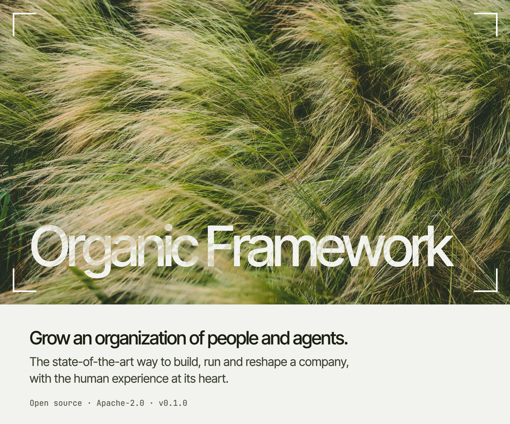

<!-- site:skip -->
<picture>
  <source media="(prefers-color-scheme: dark)" srcset="https://github.com/organic-framework/organic-framework/raw/main/.github/readme/header-dark.jpg">
  
</picture>

**[Install with your agent](#install-it-with-your-agent)** &nbsp;·&nbsp; [Quickstart by hand](#quickstart-profile-1-one-machine) &nbsp;·&nbsp; [What works today](FEATURES.md) &nbsp;·&nbsp; [Guide](docs/guide.md) &nbsp;·&nbsp; [Changelog](CHANGELOG.md) &nbsp;·&nbsp; [Apache-2.0](LICENSE)
<!-- /site:skip -->

Organic Framework (OF) organizes people and AI agents as one organization. Every job is a position, with a canonical name, a system, a role and a mandate, and a person holds a position as an agent can. OF records every agent session, and it lets you see and steer the whole organization, people and agents on one structure, from one place, on top of your agent runtime ([herdr](https://herdr.dev)) and harness (Claude Code first).

## Install it with your agent

Give your coding agent (Claude Code, for example) this repository's link and say:

> Install Organic Framework from https://github.com/organic-framework/organic-framework, following its INSTALL.md.

It asks you a few questions, installs OF, and stops where only you can act: logging in to Claude Code, trusting the new folder, and talking to your conductor. If you have a machine that stays on, such as a home server or a second computer, it suggests running herdr and the agents there, reached from your laptop over Tailscale. **Agents:** your guide is [`INSTALL.md`](INSTALL.md), in full detail. The quickstart below is the same install by hand.

## What OF gives you

| | |
|---|---|
| **Positions, held by people and agents** | Each position has a name, a system, an owner and a mandate, and its holder is a person or an agent session. Messages and questions reach a person's position as they reach an agent's. When a session is replaced or moves to another account, the position stays. |
| **One window for you** | Your conductor is the first agent you start; it takes each request to its owner. Agents ask you on cards, with options and a recommendation. |
| **Every session recorded** | Hooks record every Claude Code session as typed events in your organization's own store. Raw traces leave your machine only with your consent. |
| **A guard before every tool** | Reading secret files, printing secrets and reading process memory are denied before the tool runs. A secret that reaches a transcript anyway is masked. |

OF is early: it runs the team that builds it and one user organization today. Each feature's state, with its evidence, is in [`FEATURES.md`](FEATURES.md).

## Quickstart (profile 1: one machine)

Target: from nothing to your organization's structure in a repository, your conductor as the first agent you start, and every session recorded.

**You need:** Python 3.11+ with PyYAML, the Claude Code CLI, OpenSSH (`ssh-keygen`), and [herdr](https://herdr.dev), the agent runtime OF sits on (`brew install herdr` on macOS; other systems: herdr.dev). Without herdr, `of init` still finds agents running in tmux or plain terminals (through `claude agents`) and records them, and `of who` lists the registry, but agents get their names, live states, `of go` and the desk only in herdr panes. To move an agent into herdr without losing its session: open a herdr pane in the same directory and run `claude --resume <session id>` there (the id is in `registry/positions.yaml` after `of init`), then close the old terminal.

```bash
git clone <this repository> ~/organic-framework
ln -s ~/organic-framework/bin/of ~/.local/bin/of     # or anywhere on your PATH
python3 -c "import yaml" || python3 -m pip install --user --break-system-packages pyyaml
                                                     # Debian/Ubuntu: sudo apt install python3-yaml

of init my-org --owner "Your Name" --language en --path ~/code/my-project   # repeat --path for each directory
                                                     # --language: what your agents speak with you (en, ru, …)
                                                     # not in a terminal (a script, CI): add --yes

cd ~/of/my-org && claude --dangerously-skip-permissions   # once, if of init prints it: trust the folder (below), then /exit
of spawn my-org_conductor --config-dir ~/.claude     # your conductor: the first agent you start (docs/conductor.md)
```

**Before the first `of spawn`, open Claude Code once in the new folder.** Claude Code asks whether you trust a folder the first time it runs there, and warns once per account before it runs without asking permission. `of spawn` answers neither for you: it stops and says which one is missing. The line above opens Claude Code in `~/of/my-org`; choose "Yes, I trust this folder", accept the bypass-permissions warning, then type `/exit`. `of init` prints this line only when one of the two is missing.
- `of spawn` starts agents with `--dangerously-skip-permissions`: they run tools without asking you each time, and the guard still stops the critical ones ([`docs/guard.md`](docs/guard.md)). To have the agent ask before each tool instead, open plain `claude` in the folder (only the trust question remains) and add `--no-bypass` to `of spawn`.
- `--config-dir` is the folder of the Claude Code account to run on: `~/.claude`, unless you set `CLAUDE_CONFIG_DIR`. `of init` prints the exact line for your machine.
- `of spawn` opens a herdr pane. Without herdr, `of init` prints two lines instead that start your conductor in a terminal; run those.

`of init` does the following, and asks before it writes your Claude settings:
1. It checks the prerequisites.
2. It creates the organization's repository (`~/of/my-org`, with `registry/positions.yaml`, `AGENTS.md` and `onboarding/`).
3. It writes the structure from the onboarding package (`bench/onboarding`): you as a person holding `my-org_owner`, your conductor `my-org_conductor` first, then the onboarding unit and its run. It starts no agent. Your conductor is your one window to every agent ([`docs/conductor.md`](docs/conductor.md)); the onboarding then runs through it ([`docs/onboarding.md`](docs/onboarding.md)).
4. It lists agents already running (in herdr, or found through Claude Code) as positions for the structure keeper to name in the onboarding.
5. It lists the organization in `~/.config/of/orgs.yaml`, with what its agents start on: Opus at effort `xhigh`, unless you give `--model` and `--effort`. It keeps the language your agents use with you in `~/.config/of/owner.yaml` (`--language`; without it, it asks, or uses English).
6. It adds the recorder hooks to your Claude Code settings. The change is additive and comes with a backup and a diff.
7. It enrolls this machine and starts `of-server` with SQLite storage, as a launchd or systemd user service, and says "up" only once the server answers. Where there is no systemd user session (some VMs and containers), it says so, and you start the server yourself (below).
8. It installs the relay (message delivery between agents) and the listener (its pulse offers hand-overs and nudges) as user services, and checks that each runs: `relay: running`, `listen: running`. If one does not, it prints `NOT running` with its log and exits with code 2.

Without a terminal on stdin, `of init` cannot ask before it writes your Claude settings: it then installs nothing there, says so and exits non-zero; pass `--yes` to agree in advance.

**Agents into herdr from a terminal-only machine** (a VM, SSH): herdr needs its server running, and the agents need panes in it.

```bash
herdr server &                                      # the headless server (or just `herdr` to open its UI)
herdr workspace create --cwd ~/code/api --label my-org
herdr pane list                                     # the new workspace's first pane, e.g. w1:p1
herdr pane run w1:p1 claude --resume <session id>   # the id is in registry/positions.yaml after of init;
                                                    # close the agent's old terminal or tmux first: one session, one place
herdr pane split w1:p1 --direction right --cwd ~/code/web   # one more pane; then pane run in it
of apply                                            # names, labels and tokens on the live panes
```

If `of init` could not start of-server as a service (no systemd user session), start it in the background: `of server start` (it returns once the server answers; `of server stop` ends it; the log is `~/.local/state/of/server.log`).

**Which commands need a running herdr server:** `of apply`, `of go`, `of desk`, `of view`, delivery into panes (`of send` replies, the asks popup's answers, `of pulse` nudges) and the desk and ask counts in herdr. Without herdr, `of who` lists the registry only (with one warning), and `of ask`, `of status`, `of asks`, `of registry check`, `of import`, `of ship` and the recorder hooks work as usual.

Then:

```bash
of registry check    # validate the registry; rename positions to <system>_<role>
of apply             # canonical names, labels and tokens in herdr; each workspace is labelled with its organization
of who               # every agent, those waiting for you first
of asks              # open questions from agents, oldest first
of go <name>         # jump to an agent
```

New sessions are recorded from the next turn on. To bring in history, run `of import`.

## Commands

| | |
|---|---|
| `of init`, `of spawn`, `of resume-command` | create an organization; start a position's agent; resume a session on its own account |
| `of who`, `of go`, `of apply`, `of desk`, `of view` | see and arrange your agents |
| `of asks [withdraw\|answered]` | the questions waiting on you |
| `of ask`, `of status` | run by agents: a question to its owner on a card; where it is at the end of a turn |
| `of send`, `of inbox`, `of handover`, `of diff`, `of delegate` | messages, hand-overs and structure changes between positions; who should do a task |
| `of registry check`, `of grant issue/revoke` | the organization model and signed grants |
| `of works`, `of model`, `of studio`, `of issues`, `of loop`, `of corrections` | the organization model, its measures and problems |
| `of capacity status/plan/move/balance/reboot` | Claude accounts, their limits, and moving sessions between them |
| `of secret run/plan` | a position's credential, served by the broker at the moment of use |
| `of hooks install/uninstall`, `of hook`, `of leaks` | the recorder (Claude Code hooks) and the guard; leaked secrets counted from gitleaks reports, never shown |
| `of ingest`, `of import`, `of derive`, `of archive`, `of ship`, `of shipped`, `of consent`, `of redact`, `of db stats` | the trace store |
| `of listen`, `of pulse`, `of relay` | the background services: the listener, the 5-minute pulse, message delivery |
| `of server run/start/stop/enroll-machine/revoke/status`, `of invite`, `of enroll` | the sync server, and machines and people joining it |

`of --help` lists every command; each has its own help: `of <command> --help`.

Tests: `python3 -m unittest discover -s tests -t .` (isolated from your git config, SSH agent and home by `tests/isolate.py`).

## Deployment profiles

Profiles 2 to 4 run the same client and the same API:
- 2: self-hosted on one VM. Early: tested in the lab (`deploy/`).
- 3: scalable, with Helm, Kafka/Redpanda, a ClickHouse cluster and S3. Designed, not built.
- 4: Organic Framework Cloud. Designed, not built.

The server differs only by plugins. See [`docs/server.md`](docs/server.md), Profiles.

## Documentation

- **Start:** this quickstart, then [the guide](docs/guide.md): the ideas you need and your everyday tasks.
- **What works today:** [`FEATURES.md`](FEATURES.md), every feature by area, with its state and evidence. Changes by release: [`CHANGELOG.md`](CHANGELOG.md).
- **The framework:** [`docs/`](docs/): mission, ontology, method, systems, the registry and event schemas.
- **The platform:** the `of` CLI and `of-server`, in [`bin/`](bin/). Its design: [RFC 0001](docs/rfc/0001-organic-framework-platform.md), and the other records in [`docs/rfc/`](docs/rfc/).

## License

Apache License 2.0: see [`LICENSE`](LICENSE). The photograph at the top is by Benjamin Cheng, under the [Unsplash License](https://unsplash.com/license); it is not covered by the Apache License.
