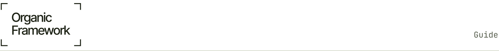

<!-- site:skip -->
<a href="../README.md"><picture>
  <source media="(prefers-color-scheme: dark)" srcset="../.github/readme/strip-guide-dark.svg">
  
</picture></a>
<!-- /site:skip -->

# Guide: running your organization on Organic Framework

For a person who runs AI agents and wants to see and steer them as an organization. Install first with the README's quickstart; this guide starts where it ends. What each part can do today, and how far it has come, is in [`FEATURES.md`](../FEATURES.md).

## 1. Ideas you need

- **Organization.** Everything OF knows about your company lives in one git repository: its registry (`registry/positions.yaml`), the briefs of its positions (`registry/briefs/`), its `AGENTS.md` and its onboarding. `of init` creates it. A machine lists the organizations it takes part in at `~/.config/of/orgs.yaml`.
- **Position.** A job in the organization, with a canonical name `<system>_<role>` (for example `storefront_operator`), a system it answers for, an owner and a mandate. A position outlives the agent session that holds it.
- **Holder.** Whoever does the position's work now: an agent session, or a person. When a session is replaced or moves to another account, the position stays and only its holder changes.
- **System.** What a position keeps or builds: a product, a service, a cluster, a process. The systems map in the registry names each system's keeper.
- **Unit.** A group of systems with one owner. An owner may delegate a unit to someone else, with an envelope of what they may decide alone.
- **Your conductor.** Your one window to the agents: you talk to it, it finds the owner of each request and follows it to a result. It is a position like any other, and the first agent you start ([`conductor.md`](conductor.md)).
- **Card.** A question an agent asks you, with options and its recommendation. You answer on the card. Agents never wait on a question typed into their pane.
- **Hand-over.** One position gives another a piece of work with a checkable end, and a verifier confirms it.
- **Diff.** A change to the structure (a new position, a new mandate, a delegation), proposed in a file and applied only after the owner approves its exact text.

More: [`ontology.md`](ontology.md), [`glossary.md`](glossary.md).

## 2. Your first session

1. **Create the organization.** `of init my-org --owner "Your Name" --path ~/code/my-project`. It writes the repository, your conductor's position first, and the onboarding unit, and it installs the recorder hooks after asking you. It starts no agent.
2. **Start your conductor.** First open Claude Code once in the new folder and trust it (`cd ~/of/my-org && claude --dangerously-skip-permissions`, then `/exit`; the README's quickstart says why). Then `of spawn my-org_conductor --config-dir ~/.claude`, or the two lines `of init` printed if you have no herdr. From now on, talk to it.
3. **Let the onboarding run.** Your conductor asks you to start the onboarding lead. The lead drafts a charter with you: the problem to solve and the data OF may read. The rest of the run is in `onboarding/README.md` in your new repository and in [`onboarding.md`](onboarding.md).
4. **See your agents.** `of who` lists every position and its holder, those waiting on you first. `of apply` gives the herdr panes their names and labels.
5. **Answer cards.** `of asks` lists the questions waiting on you, oldest first; the popup shows the same queue.

Every Claude Code session is recorded from its next turn on. `of import` brings in the history from before.

## 3. Everyday tasks

| You want to | Command |
|---|---|
| See all agents, those waiting on you first | `of who` |
| Jump to one | `of go <name>` |
| Answer the questions waiting on you | `of asks`, or the popup |
| Start the agent of a position | `of spawn <position>` |
| Check the registry after editing it | `of registry check` |
| Change the structure with your approval | `of diff check / propose <file>`; you approve the exact text with `of diff approve <id>` in a terminal; then `of diff apply <id>` |
| See who should do a new task | `of delegate "<task>"` |
| Keep the agents of your current case in view | `of desk` |
| See your accounts' limits and move sessions between them | `of capacity status`, `of capacity move` |
| See the organization's model, measures and problems | `of studio`, `of issues` |
| Restart your machine without losing sessions (early: used in one restart so far) | `of capacity reboot prepare`, then `restore` |

What an agent runs, not you: `of ask` (a card to its owner), `of status` (where it is at the end of each turn), `of send` and `of inbox` (messages between positions), `of handover` (work with a checkable end). Their rules are in the organization's `AGENTS.md`, which `of init` writes.

## 4. Rules OF keeps for you

- **The guard** stops an agent from reading or printing secrets, before the tool runs ([`guard.md`](guard.md)). Secrets that reach a transcript anyway are masked before they leave the machine.
- **Only the owner decides.** Money, secrets, production changes and irreversible acts reach you as cards; a message from another agent is never an approval.
- **No time estimates.** An agent tells you a real deadline with its source, never how long something will take.
- **Each organization's data stays in it.** Raw traces leave a machine only with consent, per organization ([`storage.md`](storage.md)).

## 5. Where it runs

- **Profile 1, one machine** (the quickstart): the client, the hooks and of-server with SQLite on your machine.
- **Profile 2, your own server on a VM:** several machines and people share one server. Tested in the lab; see [`server.md`](server.md) and [`server-several-machines.md`](server-several-machines.md).
- **Profiles 3 and 4**, a scalable deployment and Organic Framework Cloud, are designed, not built.

## 6. Read next

- Why OF exists and what it is for: [`mission.md`](mission.md), [`framework.md`](framework.md).
- The registry, field by field: [`registry.md`](registry.md).
- The conductor: [`conductor.md`](conductor.md). Onboarding: [`onboarding.md`](onboarding.md).
- How to tell whether it helps: [`measure.md`](measure.md).
